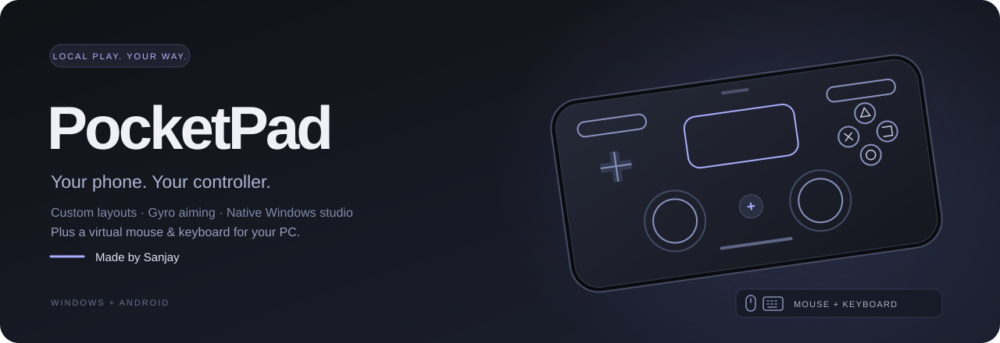
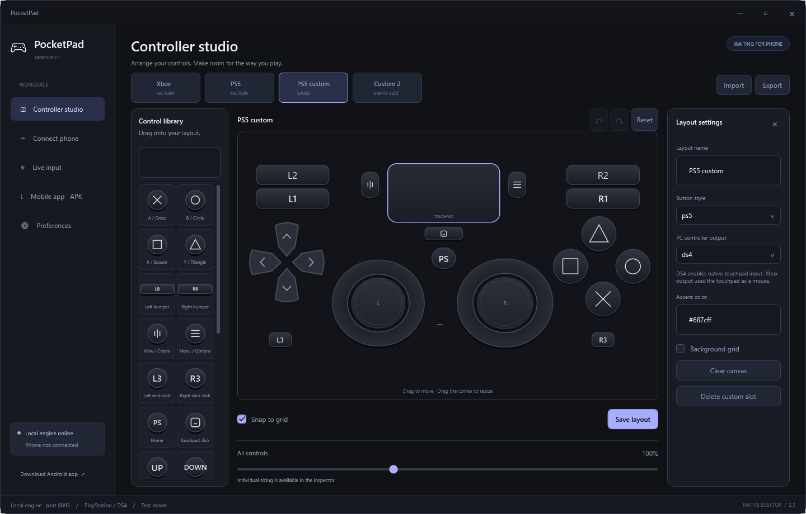
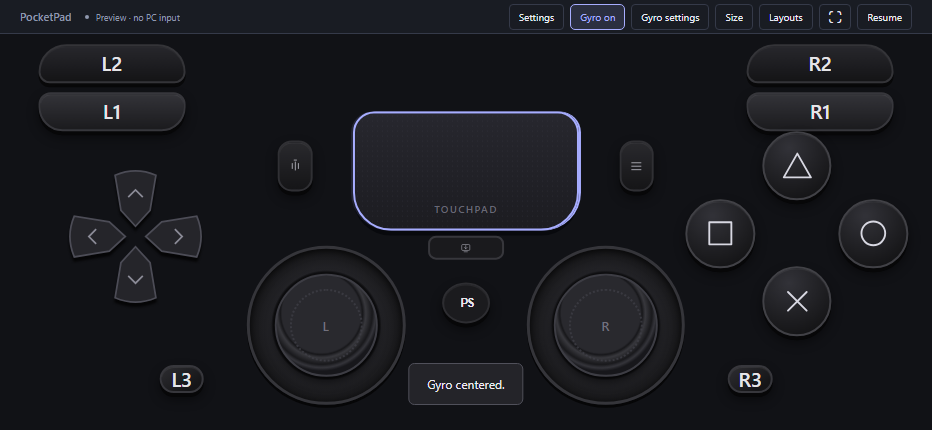
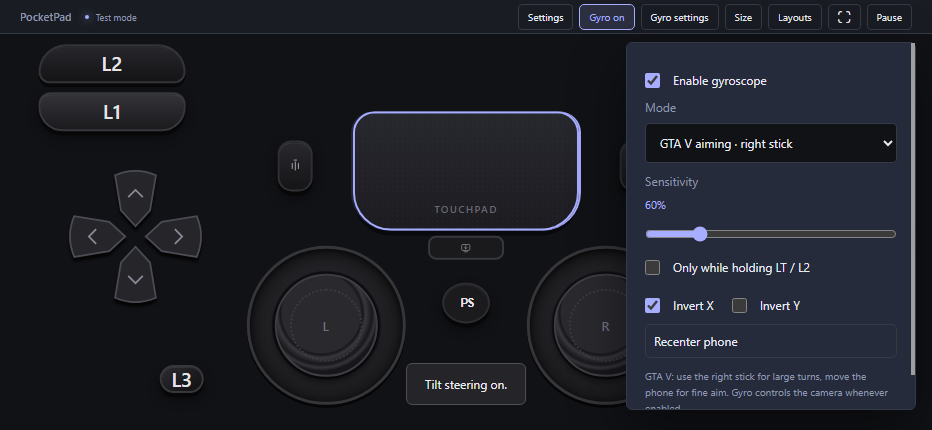
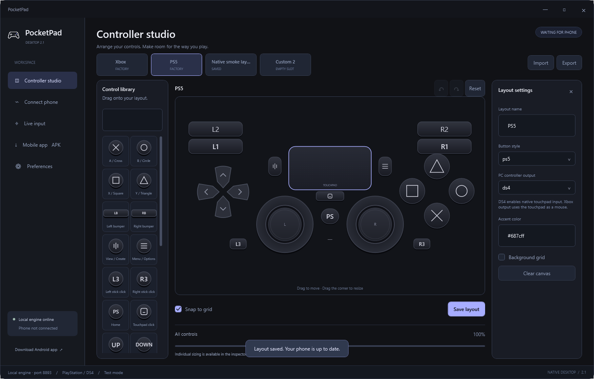
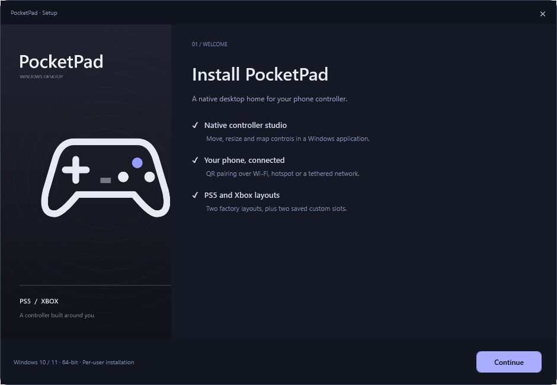

<div align="center">



### Your phone. Your layout. Your next game.

A customizable Android controller for PC games, paired with a native Windows studio.

**Made by [Sanjay](https://github.com/SanjayG-xls).**

[](https://github.com/SanjayG-xls/PocketPad/releases/latest)
[](https://github.com/SanjayG-xls/PocketPad/releases/latest)
[](#connect-your-way)

**[Download for Windows](https://github.com/SanjayG-xls/PocketPad/releases/latest/download/PocketPad-Setup.exe)** · **[Get the Android app](https://github.com/SanjayG-xls/PocketPad/releases/latest/download/PocketPad-Android.apk)** · **[Portable edition](https://github.com/SanjayG-xls/PocketPad/releases/latest/download/PocketPad-Portable.zip)**

</div>

---

PocketPad turns your phone into a touch gamepad for your PC. Build a HUD that fits your hands, scan a QR code, and send buttons, sticks, triggers, touchpad gestures and gyro input to a virtual Windows controller. Play over your local network without an account or a cloud relay.

The PC app is a **native WPF application** with its own installer. The Android companion carries the same controller styling, plus camera pairing, haptics and motion sensors. An optional phone browser controller is also included.



<p align="center"><sub>The native controller studio, captured in isolated development preview mode.</sub></p>

## Built around the way you play

| Feature | What you get |
| --- | --- |
| **Two familiar layouts** | Xbox-style and PS5-style HUDs, with matching symbols, D-pads and stick placement. |
| **Your own control surface** | A drag-and-drop library of buttons, joysticks, analog triggers, sliders, touchpad controls and HUD text. |
| **Room for bigger phones** | Individually adjustable controls, a whole-layout size slider and a separate saved phone scale. |
| **Four layout slots** | Two factory presets and two custom slots, plus JSON import/export for backups. |
| **Gyro aiming and steering** | A visible on/off button, GTA V aiming mode, tilt steering, sensitivity, invert axes and recenter. |
| **Two-finger touchpad** | Independent contacts and touchpad click with DS4 output; mouse control with Xbox output. |
| **A matching dark interface** | Matte black, OLED black and translucent themes, launch animations, transitions and connection effects. |
| **Motion on your terms** | Rich UI animations are enabled by default and can be switched off separately from gameplay gyro. |
| **A smoother first session** | An interactive walkthrough, offline controller preview, pairing QR and a dedicated mobile download page. |
| **Live feedback** | Inspect incoming inputs on the PC, see connection states, and get optional phone haptic cues. |

## Get playing

1. **Install on Windows.** Download and run [PocketPad-Setup.exe](https://github.com/SanjayG-xls/PocketPad/releases/latest/download/PocketPad-Setup.exe). Open PocketPad from the Start menu or desktop shortcut.
2. **Install the virtual controller driver if needed.** Use **Connect phone → Install virtual controller driver**, finish the bundled ViGEmBus setup, then restart Windows if requested.
3. **Install on Android.** Download [PocketPad-Android.apk](https://github.com/SanjayG-xls/PocketPad/releases/latest/download/PocketPad-Android.apk), or open the PC app's **Mobile app** page and scan its download QR. Open the APK and allow installation from that source if Android asks.
4. **Pair locally.** Put your phone and PC on the same Wi-Fi or hotspot. Open **Connect phone** on the PC, select the correct network address, then use **Scan QR code** in the Android app.
5. **Choose a layout and play.** Turn your phone sideways, tap **Start controller**, and keep the PC app running. Choose Xbox/XInput or PlayStation/DS4 output before starting your game.

**Requirements:** Windows 10/11 x64 with .NET Framework 4.8; Android 8.0+ for the companion; a reachable local network; and ViGEmBus for virtual gamepad output. The Windows downloads include the Python runtime and dependencies, so no separate Python installation is needed to play.

> Prefer a portable app? Extract the **entire** portable ZIP and run `PocketPad.exe`. Keep its runtime and supporting folders together. The driver is still required for gamepad emulation.

## Fine aim with your phone

For GTA V vehicles, the phone starts in **Driving** mode. Drag **L up** to accelerate, **left/right** to steer, and **down** to brake/reverse. Pedal pressure and steering increase with drag distance; full throttle remains available while turning. **R** looks around. Releasing L releases the pedals and centers the steering. Tap **Driving** in the toolbar to switch to **On foot** movement; the choice is saved on that phone.

Open **Gyro settings** on the phone and choose **GTA V aiming**. Switch **Gyro on** in the toolbar, hold **LT / L2**, and move the phone to adjust your aim. Use the right thumb stick for larger turns; it takes priority over gyro.

- Aiming responds to phone rotation speed and settles when you stop moving the phone.
- **Only while holding LT / L2** is enabled by default. Turn it off for continuous camera control.
- Adjust sensitivity from **25–200%**, invert either axis, or tap **Recenter phone**.
- Choose **Driving · tilt steering** to map phone tilt to the left stick instead.
- Gyro starts **off** on fresh installs. The on/off choice and tuning are remembered.

This sends ordinary controller-stick input; it does not require a game to implement native gyro support. Actual GTA V feel, sensor direction and sensitivity still need tuning on your phone.

<details>
<summary><strong>See the phone controller and gyro settings</strong></summary>





<sub>Shared controller UI captured with a simulated native bridge during input checks.</sub>

</details>

## Make the HUD yours

Start with Xbox or PS5, drag controls from the library, and move or resize them on the canvas. Customize labels, mappings, dimensions, colors, opacity and joystick deadzones. Save to either custom slot; the factory layouts stay available.

On your phone, **Size** adjusts all controls immediately and remembers that phone's preference. **Layouts** switches presets during play. Export JSON from the PC for more layouts or backups.

<details>
<summary><strong>See the PS5 layout and Windows setup</strong></summary>





</details>

## Connect your way

| Connection | How it works |
| --- | --- |
| **Wi-Fi / PC hotspot** | The main connection method. QR scanning fills in the local pairing link. |
| **USB tethering** | Uses the phone's tethered network adapter and the selected PC IP address. |
| **Bluetooth tethering / PAN** | Uses a Bluetooth network connection when both devices support it. Direct Bluetooth HID/BLE pairing is not implemented. |

Internet is not needed during play. Your devices must be able to reach each other; guest-network isolation or a VPN can prevent pairing. After a PC host restart, scan the current QR again.

## Controller support, explained

**Xbox output** creates an Xbox 360/XInput device. **PlayStation output** creates a DualShock 4 device, including two-finger touchpad input and click. The PS5 HUD describes the screen layout; it does not emulate native DualSense hardware.

Gamepad recognition depends on the game and its Steam Input settings. Adaptive triggers, game-generated rumble, native DualSense features and multiple simultaneous gamepads are not included. Bluetooth PAN is a network transport, rather than direct Bluetooth controller pairing.

The desktop, Android app, installer, input pipeline and shared UI have automated checks. Real phone camera behavior, gyro feel, Bluetooth PAN and gameplay still need physical-device validation; GTA V has not been play-tested here.

## Guides and source

| Guide | Contents |
| --- | --- |
| [User guide](docs/USER_GUIDE.md) | Layout editing, touchpad gestures, connections and troubleshooting. |
| [Windows desktop](desktop/README.md) | Native app, install/update/uninstall and saved data. |
| [Android companion](android/README.md) | APK installation, sensors, permissions and build details. |
| [Build from source](docs/BUILDING.md) | Windows and Android prerequisites, builds and checks. |
| [Release notes](CHANGELOG.md) | Desktop 2.1 / Android 1.2 release details. |
| [Third-party notices](THIRD_PARTY_NOTICES.md) | Runtime, libraries, driver and upstream acknowledgements. |

```text
PocketPad/
├── desktop/       Native C# / WPF application and original brand assets
├── android/       Android Java shell, QR scanner and sensor bridge
├── web/           Shared phone controller UI and factory layouts
├── installer/     Custom Windows setup and uninstaller
├── tools/         Build helpers, packaging and focused checks
├── docs/          Guides and real app screenshots
└── host.py        Local connection engine and virtual gamepad output
```

Build tools, personal presets, Android signing keys and generated binaries are excluded from Git. Ready-to-run downloads live in [Releases](https://github.com/SanjayG-xls/PocketPad/releases).

---

<div align="center">

**PocketPad — made by Sanjay.**

Inspired by the phone-controller workflow at [RojX](https://rojx.io), with original application code and interface assets.

Xbox and PlayStation names and marks belong to their respective owners. PocketPad is an independent project.

</div>
