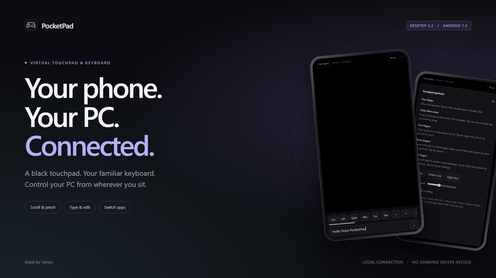
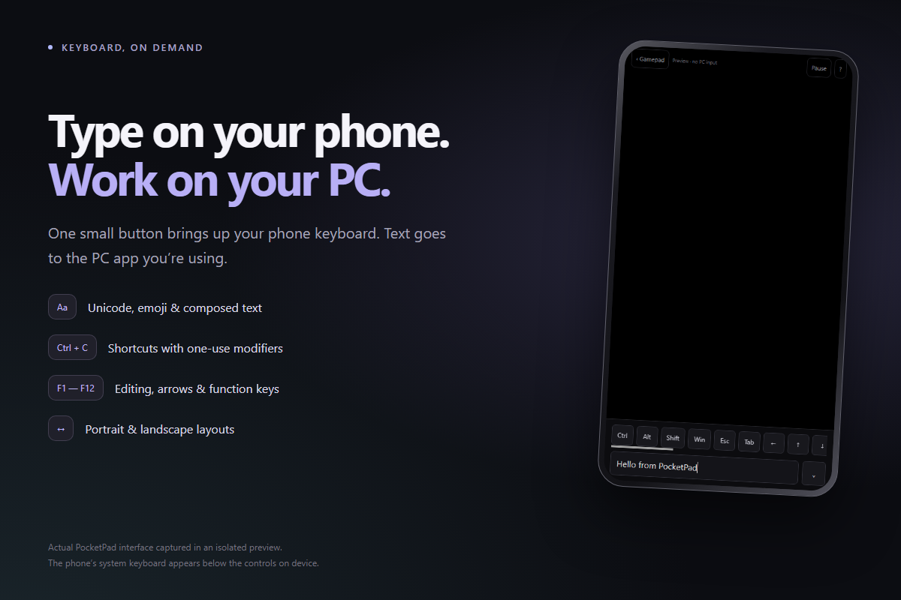
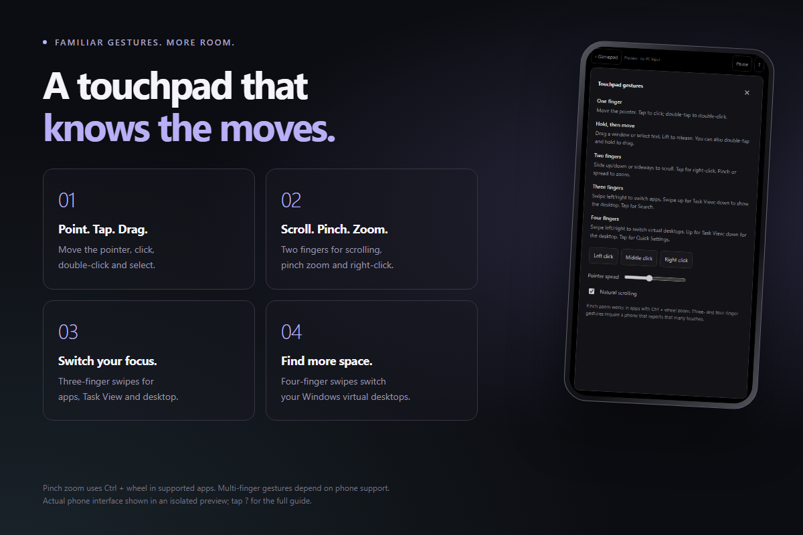

**Your phone is now a touchpad and keyboard for your PC.** Move the pointer on a clean black screen, scroll and zoom with your fingers, switch between apps, and type with your phone’s keyboard. Your Xbox and PlayStation controller layouts are still one tap away.

**Windows Desktop 2.2 · Android 1.3 · Made by [Sanjay](https://github.com/SanjayG-xls)**

## Download

| Platform | Download | Choose this for |
| --- | --- | --- |
| Windows 10/11 x64 | [**PocketPad-Setup.exe**](https://github.com/SanjayG-xls/PocketPad/releases/download/v2.2.0/PocketPad-Setup.exe) | The recommended install or update, with shortcuts and an uninstaller. |
| Android 8.0+ | [**PocketPad-Android.apk**](https://github.com/SanjayG-xls/PocketPad/releases/download/v2.2.0/PocketPad-Android.apk) | The updated Android 1.3 companion. Install over the existing app. |
| Windows portable | [**PocketPad-Portable.zip**](https://github.com/SanjayG-xls/PocketPad/releases/download/v2.2.0/PocketPad-Portable.zip) | Extract the entire ZIP and run `PocketPad.exe`. |
| Verify downloads | [SHA256SUMS.txt](https://github.com/SanjayG-xls/PocketPad/releases/download/v2.2.0/SHA256SUMS.txt) | SHA-256 checksums for all three packages. |

Update both the PC app and Android companion. Saved layouts and preferences are preserved. **Virtual mouse & keyboard does not need the ViGEmBus gamepad driver.**

## A black screen. A familiar feel.

Pair your phone and PC over the same Wi-Fi, hotspot or tethered network. Choose **Virtual mouse & keyboard** on the Android home screen, or **Mouse & keyboard** in the controller toolbar, then tap **Start controller**.

The black surface becomes your touchpad. Tap the small keyboard button to type into the focused PC app. Tap **?** for gestures, pointer speed, scroll direction and explicit mouse buttons. **Gamepad** returns to your controller.

| Type on your phone. Work on your PC. | Your everyday touchpad gestures. |
| :---: | :---: |
|  |  |

## Gestures that keep you moving

| Gesture | Action on your PC |
| --- | --- |
| One finger | Move the pointer; tap or double-tap to click or double-click. |
| Hold and move / double-tap and move | Drag windows and select text. Lift to release. |
| Two-finger slide | Scroll up/down or sideways, with adjustable natural direction. |
| Two-finger tap | Right-click. |
| Pinch / spread | Zoom out / in in apps that support Ctrl + mouse wheel. |
| Three-finger swipe left/right | Switch apps. |
| Three-/four-finger swipe up/down | Open Task View / show the desktop. |
| Three-finger tap | Open Windows Search. |
| Four-finger swipe left/right | Switch Windows virtual desktops. |
| Four-finger tap | Quick Settings on Windows 11 / Action Center on Windows 10. |

## A keyboard that speaks your language

- Type Unicode text, emoji and composed characters using your phone keyboard.
- Forward recent-text autocorrections and pasted text to the PC.
- Use Ctrl, Alt, Shift and Win modifiers for shortcuts, plus editing, navigation and F1–F12 keys.
- Work in portrait or landscape, with a compact control strip when the phone keyboard takes up screen space.
- Pause or switch modes without leaving mouse buttons held. Backgrounding, disconnect and the input watchdog also release held buttons. PocketPad does not save a typed-text log.

This release also includes **Driving / On foot** controls for GTA V: proportional left-stick throttle, braking and steering, with the right stick for looking around. Sessions start on foot; switch modes manually when entering or leaving a vehicle.

<strong>Compatibility, validation and source</strong>

Windows 10/11 x64 and .NET Framework 4.8; Android 8.0+. Keep the PC app open and both devices on a reachable local network. The optional phone browser controller also supports mouse/keyboard mode. Gamepad emulation still needs ViGEmBus.

These gestures send Windows mouse and keyboard inputs. They do not install a Windows Precision Touchpad device or inherit its custom gesture settings. Three-/four-finger gestures depend on the phone and OS; pinch zoom depends on the PC app. Windows can block input to higher-privilege apps and the secure UAC screen.

Automated validation covers phone gestures, Unicode/IME/autocorrect, Windows input packet layout, paired-phone ownership, gamepad isolation, pause/reconnect, APK contents/signature, and Windows install/update/uninstall with layout retention. Physical-phone gesture feel, native keyboard behavior and application-specific zoom still need hands-on validation.

The images show the actual PocketPad interface in an isolated preview. The phone’s native system keyboard appears on device; it is not pictured in these preview captures.

[User guide](https://github.com/SanjayG-xls/PocketPad/blob/v2.2.0/docs/USER_GUIDE.md#virtual-mouse--keyboard) · [Build from source](https://github.com/SanjayG-xls/PocketPad/blob/v2.2.0/docs/BUILDING.md) · [Changes since v2.1.0](https://github.com/SanjayG-xls/PocketPad/compare/v2.1.0...v2.2.0)

